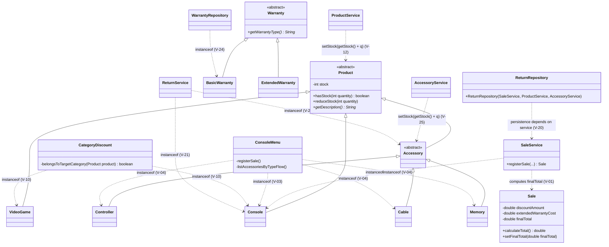
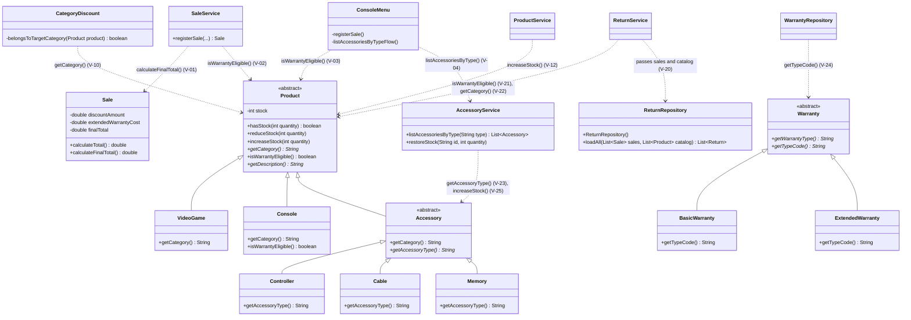

# GRASP Class Diagram

Classes changed by the GRASP refactor, before (`develop` at `2f00b33`) and after
(`feature/grasp-refactor`). Only the members involved in the corrections are shown. The ID on
each note is the violation from `docs/grasp-audit/consolidated-audit.md`.

## Before

## After

## Still open after GRASP

- **V-05** `SaleService` and `WarrantyService` still depend on each other through
  `setWarrantyService`. Fixed in Requirement 8 with `SaleLookup` (V-32).
- **V-06** `SaleService` still uses the concrete `SaleRepository`. Fixed in Requirement 8 (V-31).
- **V-26** `WarrantyService` still receives whole `SaleService` and `ProductService`. Fixed in
  Requirement 8 (V-55).
